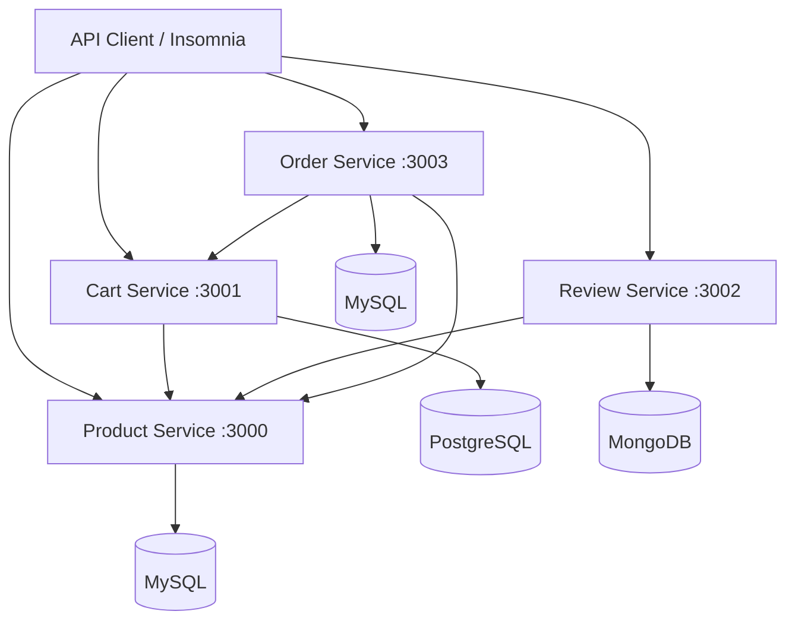

# E-Commerce Microservices

Repository ini berisi sistem e-commerce berbasis arsitektur microservices. Sistem terdiri dari Product Service, Cart Service, Review Service, dan Order Service. Setiap service berjalan sebagai aplikasi terpisah dan menggunakan database masing-masing.

## 1. Architecture

### Service Overview

| Service | Technology | Database | Port |
|---|---|---|---:|
| Product Service | Node.js, Express | MySQL 8 | 3000 |
| Cart Service | Laravel | PostgreSQL 16 | 3001 |
| Review Service | Python, Flask | MongoDB 7 | 3002 |
| Order Service | Laravel | MySQL 8 | 3003 |

### Architecture Diagram



Order Service berkomunikasi dengan Product Service untuk validasi produk dan harga, serta Cart Service untuk mengambil isi keranjang dan menyelesaikan checkout. Cart Service dan Review Service juga menggunakan Product Service sesuai konfigurasi masing-masing.

## 2. Requirements

Pastikan perangkat sudah memiliki:
- Docker
- Docker Compose
- Git
- Insomnia atau API client sejenis

## 3. Running the Application

Clone repository:

```bash
git clone https://github.com/isssmelianii-ui/mi-pdsku.git
cd mi-pdsku
```

Build dan jalankan seluruh service:

```bash
docker compose up --build -d
```

Periksa status container:

```bash
docker compose ps
```

Lihat log seluruh service:

```bash
docker compose logs -f
```

Lihat log Order Service:

```bash
docker compose logs -f order-service
```

Hentikan container:

```bash
docker compose down
```

Database menggunakan named volumes agar data tetap tersedia setelah container dihentikan. Hindari `docker compose down --volumes` apabila data database ingin dipertahankan.

## 4. API Endpoints

### Product Service

Base URL: `http://localhost:3000`

| Method | Endpoint | Description |
|---|---|---|
| GET | `/health` | Health check |
| GET | `/products` | Get all products |
| GET | `/products/{id}` | Get product by ID |
| POST | `/products` | Create product |
| PUT | `/products/{id}` | Update product |
| DELETE | `/products/{id}` | Delete product |

### Cart Service

Base URL: `http://localhost:3001`

| Method | Endpoint | Description |
|---|---|---|
| GET | `/carts/{userId}` | Get cart by user ID |
| POST | `/carts` | Add item to cart |
| PUT | `/carts/items/{id}` | Update cart item |
| DELETE | `/carts/items/{id}` | Delete cart item |
| DELETE | `/carts/{userId}` | Clear user cart |

Cart Service berkomunikasi dengan Product Service untuk memvalidasi produk sebelum item ditambahkan ke keranjang.

### Review Service

Base URL: `http://localhost:3002`

| Method | Endpoint | Description |
|---|---|---|
| POST | `/api/reviews` | Create review |
| GET | `/api/reviews` | Get all reviews |
| GET | `/api/reviews/{review_id}` | Get review by ID |
| GET | `/api/reviews/product/{product_id}` | Get reviews by product |
| PUT | `/api/reviews/{review_id}` | Update review |
| DELETE | `/api/reviews/{review_id}` | Delete review |

### Order Service

Base URL: `http://localhost:3003`

| Method | Endpoint | Description |
|---|---|---|
| GET | `/health` | Health check |
| POST | `/orders` | Create order / checkout |
| GET | `/orders/{id}` | Get order detail |
| GET | `/orders/user/{userId}` | Get orders by user |
| PATCH | `/orders/{id}/pay` | Pay an order |

#### Create Order

Request:

```http
POST /orders
Content-Type: application/json
```

```json
{
  "user_id": 8
}
```

Order Service mengambil item dari keranjang, memvalidasi produk dan stok, membuat order beserta order items, kemudian menyimpan snapshot harga produk pada saat transaksi.

#### Response Status

| HTTP Status | Meaning |
|---|---|
| 201 | Order berhasil dibuat |
| 404 | Order atau resource tidak ditemukan |
| 409 | Konflik transaksi, misalnya keranjang kosong atau stok tidak mencukupi |
| 422 | Validasi request gagal |
| 503 | Service dependency tidak tersedia |

## 5. Environment Configuration

Variabel utama yang digunakan melalui Docker Compose:

| Service | Environment Variables |
|---|---|
| Product Service | `DB_HOST`, `DB_USER`, `DB_PASSWORD`, `DB_NAME` |
| Cart Service | `DB_CONNECTION`, `DB_HOST`, `DB_PORT`, `DB_DATABASE`, `DB_USERNAME`, `DB_PASSWORD`, `PRODUCT_SERVICE_URL`, `LOG_CHANNEL` |
| Review Service | `HOST`, `PORT`, `FLASK_DEBUG`, `MONGO_URI`, `MONGO_DB_NAME`, `PRODUCT_SERVICE_URL` |
| Order Service | `APP_URL`, `DB_CONNECTION`, `DB_HOST`, `DB_PORT`, `DB_DATABASE`, `DB_USERNAME`, `DB_PASSWORD`, `PRODUCT_SERVICE_URL`, `CART_SERVICE_URL`, `LOG_CHANNEL` |

Template environment Order Service tersedia di `order-service/.env.example`. Jangan memasukkan file `.env` yang berisi kredensial atau rahasia ke repository publik.

## 6. Order Service Design Decisions

- Order Service dipisahkan dari Product Service dan Cart Service.
- Komunikasi antarlayanan menggunakan HTTP.
- Data order dan order items disimpan dalam database Order Service.
- Harga produk disimpan sebagai snapshot pada order item agar perubahan harga produk berikutnya tidak mengubah riwayat transaksi.
- Validasi produk dan stok dilakukan sebelum order diselesaikan.
- Kegagalan komunikasi dengan service dependency ditangani menggunakan response error yang sesuai.
- Kegagalan pengosongan cart ditangani agar kegagalan proses tersebut tidak dianggap berhasil tanpa konfirmasi.

## 7. Limitations

- Checkout bergantung pada ketersediaan Product Service dan Cart Service.
- Setiap service memiliki database terpisah.
- Konfigurasi Docker Compose ditujukan untuk lingkungan development.
- Pembayaran saat ini berupa perubahan status order menjadi PAID, bukan integrasi payment gateway.

## 8. Repository Structure

```text
mi-pdsku/
|-- cart-service/
|-- product-service/
|-- review-service/
|-- order-service/
|-- docker-compose.yml
|-- README.md
```

## 9. Testing

Pengujian API dilakukan menggunakan Insomnia. Pengujian Order Service mencakup:
- Health check.
- Checkout order.
- Validasi user ID.
- Pengambilan detail order.
- Pengambilan daftar order berdasarkan user.
- Pembayaran order.
- Skenario kegagalan transaksi dan komunikasi antarlayanan.

## 10. Demo

Video demonstrasi sistem: **TBA**

## 11. Submission Information

- **Repository:** https://github.com/isssmelianii-ui/mi-pdsku
- **Demo Video:** TBA
- **Final Commit SHA:** TBA


